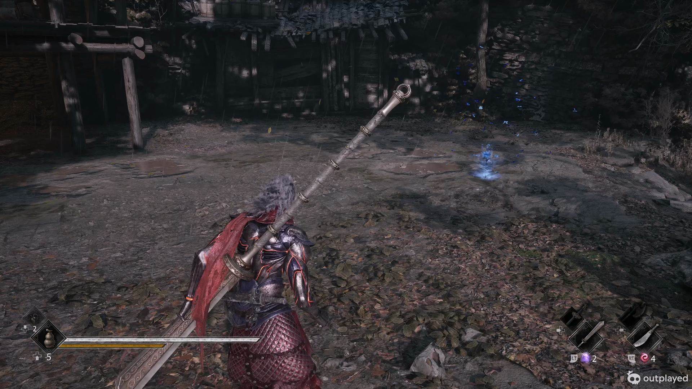

# PBZ_UHSMFF — Undying Heroic Spirit Memory Flower Fix

A [UE4SS](https://github.com/UE4SS-RE/RE-UE4SS) Lua mod for **Phantom Blade Zero** that fixes the *Undying Heroic Spirit* (不灭侠胆) side quest soft-lock.

**Download on Nexus Mods:** https://www.nexusmods.com/phantombladezero/mods/259

[中文说明](#中文)

## The problem

In *Undying Heroic Spirit* you find NPCs fighting a group of enemies. After the fight they turn hostile, and killing them should spawn their **Memory Flower** at the encounter spot. If you kill them too late, or the NPC bugs out, the flower never spawns. The quest needs four Memory Flowers to turn in; if a bug leaves you with fewer than four, you can't hand in the quest.

Some saves also get stuck in "free exploration" with no objective, even after collecting four or more flowers, so the quest can never be completed and the reward is never granted.

## Hotkeys

| Key | What it does |
|---|---|
| **F8** | **Restore memories.** Every NPC that was killed but never dropped a Memory Flower gets it back; the flower reappears at the encounter spot. NPCs not met, still alive, or with the flower already obtained are left untouched. |
| **F10** | **Complete the quest.** With 4+ memories and the quest accepted but not completed, the quest is completed and the reward **Undying Heroic Spirit** (不灭侠胆) is granted. |

F11 is not used because the game uses it to toggle window scaling.

## How it works

- **F8** calls the game's own `EventPipelineManager:AddTagsByString` to add the missing memory tag, so the memory flow continues the normal way.
- **F10** adds the matching `任务进度N` progress tags, clears the `任务失败` (quest failed) flag, moves the quest `BuMieXiaDan_C` into its completion state, then grants the reward item `TU_19006` with `PBZBackPackSubsystem:AddPropsToBackPack`. The reward is only granted when the mod itself completed the quest, and never if you already own it.

| # | NPC | Death tag | Memory tag |
|---|---|---|---|
| 1 | 紫衣双刃 | `zddy.不灭侠胆.紫衣双刃死亡` | `pz.不灭侠胆.帮助正道解脱1` |
| 2 | 双剑 | `pz.不灭侠胆.双剑怪死亡` | `pz.不灭侠胆.帮助正道解脱2` |
| 3 | 紫衣剑客 | `zddy.不灭侠胆.紫衣剑客死亡` | `pz.不灭侠胆.帮助正道解脱3` |
| 4 | 刀卫 | `pz.不灭侠胆.刀卫怪死亡` | `pz.不灭侠胆.帮助正道解脱4` |
| 5 | 白山护法 | `zddy.不灭侠胆.白山护法死亡` | `pz.不灭侠胆.帮助正道解脱5` |
| 6 | 护法 | `pz.不灭侠胆.护法怪死亡` | `pz.不灭侠胆.帮助正道解脱6` |

## Installation

1. Install UE4SS.
2. Copy this folder into UE4SS's `Mods` folder as `PBZ_UHSMFF` (Steam: `PBZ\platform\steam\ue4ss\Mods\PBZ_UHSMFF`).
   It must contain `Scripts\main.lua` and `enabled.txt`.
3. Back up your save (`ProjectPBZ\Saved\SaveGames\`).
4. Load your save:
   - Missing flowers: press **F8**, then pick up the Memory Flower at the encounter spot.
   - 4+ memories but the quest can't be handed in: press **F10**.
5. Check the result, then save.

Results are written to `ue4ss\UE4SS.log` (search for `PBZ_UHSMFF`).

## UE4SS stopped working after a game update?

If no mod responds and `ue4ss\UE4SS.log` has no `GUObjectArray address:` line, the game update broke UE4SS's signature, not this mod. Replace `ue4ss\UE4SS_Signatures\GUObjectArray.lua` with the update-resistant version from [PBZ_UE4SS_GUObjectArray](https://github.com/adv-inn/PBZ_UE4SS_GUObjectArray). Check its README first to see whether it fits your UE4SS package.

## Changelog

- **1.1.1** — README: how to fix UE4SS after a game update. Verified on the 2026-11-04 game update; no functional changes.
- **1.1.0** — Added F10 to complete the quest and grant the reward. Restore hotkey changed from Ctrl+F11 to F8.
- **1.0.0** — Ctrl+F11 restores missing memories.

## License

[MIT](LICENSE) © 2026 M4kis3Kurisu

This is an unofficial fan-made mod and is not affiliated with or endorsed by the developers of Phantom Blade Zero.

---

## 中文

适用于《影之刃零》的 UE4SS Lua mod，修复支线「不灭侠胆」卡任务的问题。

**Nexus Mods 下载**：https://www.nexusmods.com/phantombladezero/mods/259

**问题**：支线中的 NPC 与小怪战斗结束后会转为敌对，击杀后应在遭遇位置生成记忆之花。击杀得太晚或 NPC 出现异常时，记忆之花不会生成。任务需要交付 4 朵记忆之花，如果因此少于 4 朵，就无法交任务。另外，有的存档即使已经收集了 4 朵以上，任务也会卡在“自由探索、没有目标”的状态，既无法完成，也拿不到奖励。

**按键**：

| 按键 | 功能 |
|---|---|
| **F8** | **补发记忆**：已击杀但没有生成记忆之花的 NPC，补发对应的记忆，记忆之花会在原遭遇位置重新出现。未遇到、仍存活、已拿到记忆的不做改动。 |
| **F10** | **完成任务**：记忆达到 4 朵、任务已接取但未完成时，把任务推进到完成，并发放奖励「不灭侠胆」。 |

不使用 F11，因为游戏中 F11 会切换窗口缩放。

**说明**：F10 只在本次由 mod 完成任务时发放「不灭侠胆」，背包里已有则不重复发放；任务尚未向紫衣狼统领接取时，F10 不做任何改动。

**安装**：

1. 安装 UE4SS。
2. 把本文件夹以 `PBZ_UHSMFF` 为名放入 UE4SS 的 `Mods` 文件夹（Steam 版：`PBZ\platform\steam\ue4ss\Mods\PBZ_UHSMFF`），确保包含 `Scripts\main.lua` 和 `enabled.txt`。
3. 备份存档（`ProjectPBZ\Saved\SaveGames\`）。
4. 读档进入游戏：
   - 缺记忆时按 **F8**，然后到原遭遇位置拾取记忆之花；
   - 记忆达到 4 朵但无法交付时按 **F10**。
5. 确认结果后存档。

结果写在 `ue4ss\UE4SS.log` 中（搜索 `PBZ_UHSMFF`）。

**游戏更新后 UE4SS 失效？** 如果按键没有任何反应，且 `ue4ss\UE4SS.log` 中没有 `GUObjectArray address:` 这一行，说明是游戏更新导致 UE4SS 的签名失效，不是本 mod 的问题。可以用 [PBZ_UE4SS_GUObjectArray](https://github.com/adv-inn/PBZ_UE4SS_GUObjectArray) 中能扛住更新的版本替换 `ue4ss\UE4SS_Signatures\GUObjectArray.lua`。替换前请先看它的说明，确认适用于你的 UE4SS 整合包。

**更新记录**：
- **1.1.1**：说明中补充游戏更新后 UE4SS 失效的处理方法；已在 2026-11-04 游戏更新后验证，功能无改动。
- **1.1.0**：新增 F10 完成任务并发放「不灭侠胆」；补发记忆的按键由 Ctrl+F11 改为 F8。
- **1.0.0**：Ctrl+F11 补发缺失的记忆。

**许可证**：[MIT](LICENSE) © 2026 M4kis3Kurisu。本 mod 为非官方玩家作品，与《影之刃零》开发商无关。
